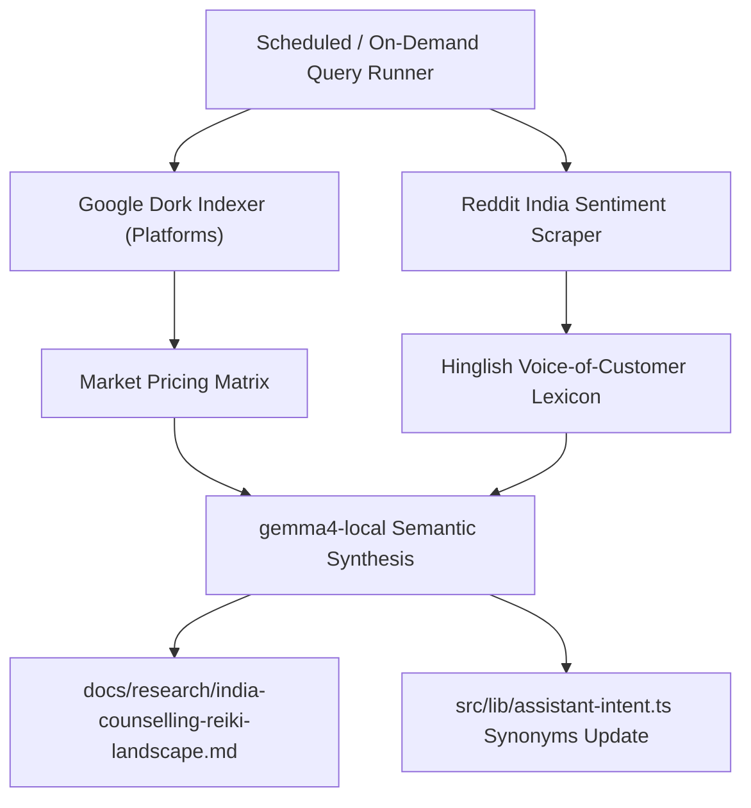

# Reusable Competitive & Sentiment Research Automation Workflow

This guide details the repeatable Google `site:` search queries, Reddit community audit scripts, and synthesis commands for tracking Indian mental health platforms and client sentiment trends for **Dr. Shivie Gupta's** practice.

---

## 1. Quick Local Execution via Headless Node Runner

Run the preconfigured research scanner locally to sample live competitor rankings and community discussions:

```bash
# Run the local research probe (requires Node 18+)
node scripts/run-competitive-research.mjs
```

---

## 2. Targeted Search Indexing Dorks

### Competitor Pricing & Platform Audits
```text
# Aggregator Pricing Tiers
site:amahahealth.com (pricing OR fee OR "per session")
site:betterlyf.com (pricing OR "online counselling" OR fee)
site:heartitout.in ("therapy cost" OR pricing OR fees)
site:manastha.com ("counselling charges" OR pricing)
site:yourdost.com (plans OR pricing)

# Senior Independent Counselors in India
"counselling psychologist" "years of experience" (India OR Delhi OR Agra) (fee OR pricing)
"couple counselling" India ("fee per session" OR "charges")

# Distance & Online Reiki in India
"Reiki healing" India ("distance reiki" OR "online session") (fee OR charges)
```

### Reddit India Client Sentiment Dorks
```text
# Privacy & Domestic Friction
site:reddit.com/r/MentalHealthIndia ("phone therapy" OR "audio call" OR privacy OR "overhearing")
site:reddit.com/r/TwoXIndia ("therapist recommendation" OR "counselling experience" OR in-laws)
site:reddit.com/r/IndianRelationships ("couple counselling" OR "marriage therapy" OR "worth it")

# Aggregator App Complaints & Churn
site:reddit.com/r/MentalHealthIndia ("Amaha" OR "BetterLYF" OR "MindPeers" OR "YourDOST") (experience OR review OR bad)

# Reiki & Somatic Openness vs. Skepticism
site:reddit.com ("Reiki" OR "energy healing") (India OR Delhi OR Bangalore) (scam OR helped OR relaxation)
```

---

## 3. Workflow Automation Pipeline



---

## 4. Maintenance Guidelines
- Run this audit quarterly or when re-evaluating session fees.
- Never hardcode dynamic competitor claims into public copy—use findings to position Dr. Shivie Gupta's authentic seniority and voice-only discretion.
